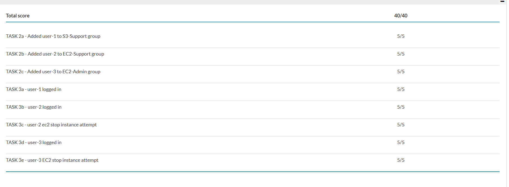

# AWS IAM User Management

## Project Overview
This project demonstrates how to manage access to AWS resources using AWS Identity and Access Management (IAM).

The goal is to implement role-based access control by assigning IAM users to groups with specific permissions based on their job responsibilities.

## Business Scenario
A growing company uses Amazon EC2 and Amazon S3. Different employees require different levels of access depending on their roles.

The solution uses IAM Users, Groups, and Policies to enforce the principle of least privilege.

## AWS Services Used
- AWS Identity and Access Management (IAM)
- Amazon EC2
- Amazon S3

## Implementation

### 1. IAM Users
Three IAM users were provided:
- user-1
- user-2
- user-3

### 2. IAM Groups and Permissions

| IAM Group | Attached Policy | Access |
|---|---|---|
| S3-Support | AmazonS3ReadOnlyAccess | Read-only S3 |
| EC2-Support | AmazonEC2ReadOnlyAccess | Read-only EC2 |
| EC2-Admin | Inline Policy | Describe, Start and Stop EC2 |

### 3. User Assignment

| User | Group | Responsibility |
|---|---|---|
| user-1 | S3-Support | S3 Support |
| user-2 | EC2-Support | EC2 Support |
| user-3 | EC2-Admin | EC2 Administration |

### 4. Permission Testing
Each user was used to test access to AWS services according to the assigned permissions.

Expected behavior:
- user-1: Can view Amazon S3 resources but cannot access EC2 resources.
- user-2: Can view EC2 resources but cannot modify instances.
- user-3: Can describe, start, and stop EC2 instances.

## Key Concepts Learned
- IAM Users and Groups
- Managed Policies vs Inline Policies
- IAM Permissions
- Read-only vs Administrative Access
- Role-Based Access Control (RBAC)
- Principle of Least Privilege
- Testing AWS permissions

## Project Outcome
Successfully completed the AWS IAM hands-on lab and achieved a score of **40/40**.

## Skills Demonstrated
AWS IAM | Cloud Security | Access Management | AWS EC2 | Amazon S3 | Troubleshooting
## Lab Results

Successfully completed the AWS IAM Lab with a score of 40/40.

flowchart TB
    A["AWS IAM"]

    A --> U1["user-1"]
    A --> U2["user-2"]
    A --> U3["user-3"]

    U1 --> G1["S3-Support"]
    U2 --> G2["EC2-Support"]
    U3 --> G3["EC2-Admin"]

    G1 --> P1["AmazonS3ReadOnlyAccess"]
    G2 --> P2["AmazonEC2ReadOnlyAccess"]
    G3 --> P3["Inline Policy"]

    P1 --> S3["Amazon S3"]
    P2 --> EC2["Amazon EC2 - Read Only"]
    P3 --> EC2A["Amazon EC2 - Describe / Start / Stop"]

## Disclaimer
This project was completed in a controlled AWS lab environment. No production resources or credentials are included.
